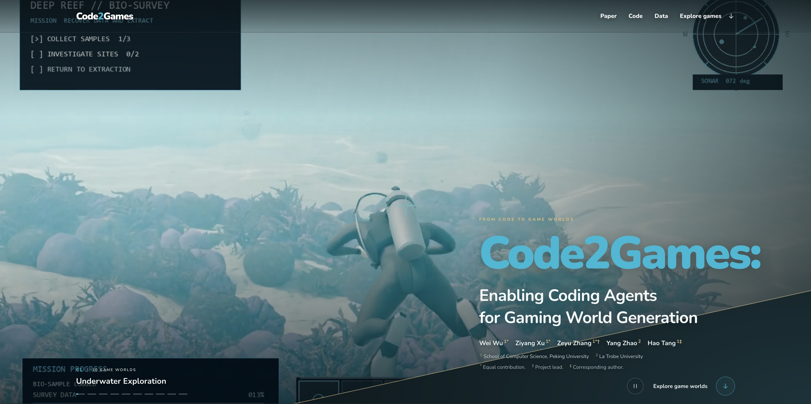
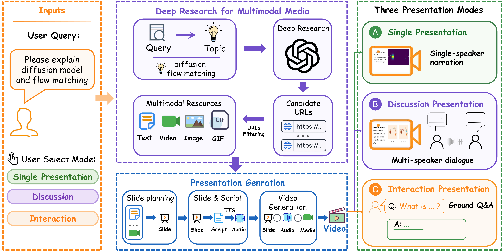

<h3>👋 Hi, I'm Wei Wu!</h3>

  
    
  

## Biography

I am a Master's student at the University of Electronic Science and Technology of China (UESTC). I also collaborate closely with [Prof. Hao Tang](https://ha0tang.github.io/) (PKU), [Prof. Haidong Kang](https://haidong-kang.github.io/) (NEU), and [Zeyu Zhang](https://github.com/steve-zeyu-zhang) (AIGeeks).

My research interests primarily focus on AI Agents and Gaming Agents and I am also deeply interested in World Models

If you are interested in my research or potential collaborations, please feel free to reach out via [email](mailto:wuwei5937@gmail.com).

## Selected Publications

<blockquote>
  <b>Code2Games: Enabling Coding Agents for Gaming World Generation</b>
  

    <a href="https://github.com/weiwu-7"><b>Wei Wu</b></a>*,
    <a href="https://github.com/xzy-Zayn">Ziyang Xu</a>*,
    <a href="https://github.com/steve-zeyu-zhang">Zeyu Zhang</a>*†,
    Yang Zhao,
    <a href="https://ha0tang.github.io/">Hao Tang</a>‡
  

  

    
    
    
    
    
  

  
</blockquote>

<blockquote>
  <b>PresentAgent-2: Towards Generalist Multimodal Presentation Agents</b>
  

    <a href="https://github.com/weiwu-7"><b>Wei Wu</b></a>*,
    <a href="https://github.com/xzy-Zayn">Ziyang Xu</a>*,,
    <a href="https://github.com/steve-zeyu-zhang">Zeyu Zhang</a>*†,
    Yang Zhao,
    <a href="https://ha0tang.github.io/">Hao Tang</a>‡
  

  

    
    
    
    
    
  

  
</blockquote>

* Equal contribution. † Project lead. ‡ Corresponding author.
